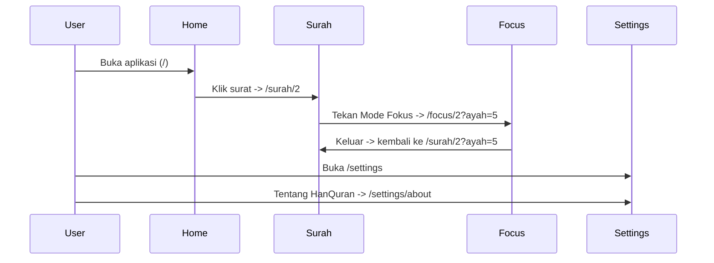

# 14 — Spesifikasi Routing HanQuran

Dokumen ini mendokumentasikan seluruh rute aplikasi HanQuran (App Router Next.js). Ditujukan untuk developer baru agar memahami URL, tujuan halaman, komponen utama, dan aksi yang dapat dilakukan pengguna.

Semua penjelasan menggunakan Bahasa Indonesia dan mengikuti implementasi saat ini di folder `hanquran-app`.

**Terakhir disinkronkan dengan kode:** 2 November 2026 (versi `0.6.0`).

---

**Catatan teknis**
- Routing mengikuti Next.js App Router (folder `app/`).
- Helper route tersedia di `lib/routes.ts` dan harus dipakai untuk membuat link agar perubahan shape route terpusat.

---

## Ringkasan rute yang ada (implementasi saat ini)

1. URL: `/`
   - Nama halaman: Home (Beranda)
   - Tujuan: Menampilkan daftar surat, pencarian, filter favorit, dan kartu "Lanjutkan Hafalan".
   - Render: server component **SSG** → `HomeClient` (daftar 114 surat ada di HTML awal, `docs/36`).
   - Komponen utama: `Header`, `ContinueReading`, `SearchInput`, `FilterChips`, daftar `SurahCard`.
   - Aksi pengguna: Cari surat, buka halaman surat, tandai favorit, navigasi ke pengaturan.

2. URL: `/surah/[id]` (contoh: `/surah/2`)
   - Nama halaman: Surah Detail
   - Tujuan: Menampilkan seluruh ayat sebuah surat, kontrol audio, dan opsi repeat/fokus.
   - Render: server component **SSG** untuk id 1–114 (`generateStaticParams`); id lain → **404** (`dynamicParams = false`). Interaksi di `SurahDetailClient`.
   - Komponen utama: `SurahDetailHeader`, `VerseDisplayControls`, daftar `AyahCard`, `AudioPlayer` (dengan `RepeatSelector` inline), `RepeatSettingsDialog`, `SurahDetailScrollSpacer`.
   - Aksi pengguna: Pilih ayat aktif, putar / jeda audio, lompat ayat, toggle Terjemahan/Transliterasi, buka Mode Fokus, buka pengaturan repeat, tandai favorit.
   - Query opsional: `?ayah=<number>` untuk membuka halaman pada ayat tertentu. Nilai divalidasi `parseAyahParam` lalu diklem ke `1..jumlah ayat`; tidak valid → ayat 1. Reaktif terhadap back/forward lewat `StartAyahSync`.

3. URL: `/focus/[id]` (contoh: `/focus/2`)
   - Nama halaman: Focus Mode (Mode Fokus)
   - Tujuan: Layar baca bebas distraksi — satu ayat nyata (Arab + transliterasi/terjemahan sesuai preferensi). **Tanpa** word-by-word highlight pada MVP V1 (`docs/24-focus-mode-mvp-scope.md`).
   - Komponen utama: teks ayat, `AudioPlayer` (repeat inline), `RepeatSettingsDialog`.
   - Aksi pengguna: Putar/jeda audio ayat, navigasi ayat sebelumnya/berikutnya, ubah repeat cepat atau buka pengaturan repeat, keluar ke halaman surah.
   - Query opsional: `?ayah=<number>` untuk memulai dari ayat tertentu (validasi sama dengan Surah Detail).
   - Render: client page, static params 1–114, `noindex`.

4. URL: `/settings`
   - Nama halaman: Pengaturan
   - Tujuan: Menyediakan konfigurasi aplikasi seperti pilihan qari, ukuran teks, status offline/cache, aksesibilitas, playback, dan navigasi ke Tentang HanQuran.
   - Komponen utama: `SettingsHeader`, `SettingsSection`, `SettingsRow`, `OfflineStatusBadge`, primitives (`Select`, `Switch`, `SegmentedControl`).
   - Aksi pengguna: Ubah qari, ubah preferensi tampilan, ubah Auto Follow Playback, ubah Mode Murotal, hapus cache, lihat status offline, buka Tentang HanQuran.

5. URL: `/settings/about`
   - Nama halaman: Tentang HanQuran
   - Tujuan: Menampilkan informasi resmi aplikasi — nama, versi, deskripsi, tujuan & filosofi, credits, repository & lisensi.
   - Komponen utama: `AboutPage`, `SettingsSection`, metadata dari `lib/app-about.ts`, credits dari `data/about-credits.ts`.
   - Aksi pengguna: Baca informasi aplikasi, buka tautan eksternal (repository, sumber audio), kembali ke Pengaturan.
   - Spesifikasi: `docs/26-about-screen-spec.md`.

---

6. Rute teknis
   - `/sitemap.xml`, `/robots.txt` — dari `app/sitemap.ts` & `app/robots.ts` (`docs/35`). Sitemap hanya Beranda + 114 surat; `/focus/*` dan `/settings*` `noindex`.
   - `/surah/0`, `/focus/0` → redirect ke `/` (`vercel.json`).
   - Build Android (static export): link memakai bentuk file, mis. `/surah/2.html?ayah=5` (`toStaticExportHref` di `lib/routes.ts`).

---

## Ide Rute di Luar Scope (tidak dijadwalkan)

> **Bukan bagian MVP dan tidak ada di backlog aktif.** Dicatat hanya sebagai ide. Jangan diimplementasikan tanpa keputusan baru di `docs/20` (Change Control) / `docs/18`.

- `/favorites`
  - Tujuan: Halaman yang menampilkan semua surat favorit pengguna (mempermudah navigasi dan manajemen favorit).
  - Komponen utama: ulang `SurahCard` list, `Header`, kemampuan mengurutkan / hapus favorit.
  - Kenapa direkomendasikan: memisahkan daftar favorit meningkatkan discoverability dan UX.

- `/search` (opsional sebagai route; saat ini pencarian berada di Home)
  - Tujuan: Halaman pencarian penuh dengan hasil terfilter dan opsi lanjutan.
  - Komponen utama: `SearchInput`, hasil `SurahCard` dan highlight kata, filter lanjutan.
  - Kenapa: jika fitur pencarian diperluas, halaman khusus membantu UX dan history.

- `/offline` (status & manajemen cache)
  - Tujuan: Halaman yang menunjukkan detail status offline, progress unduhan, dan pengelolaan cache.
  - Komponen utama: `OfflineStatusBadge`, kontrol unduh / batalkan, daftar file audio yang tersimpan.
  - Kenapa: memberi transparency dan kontrol bagi pengguna offline-first.

- `/profile` (opsional untuk user-specific data)
  - Tujuan: Menyimpan preferensi pengguna, sinkronisasi (jika ada), dan data kemajuan hafalan.

---

## Diagram Hierarki Route (Mermaid)

```mermaid
flowchart TB
  A[Home (/)] --> B[Surah Detail (/surah/[id])]
  B --> C[Focus Mode (/focus/[id])]
  A --> D[Settings (/settings)]
  D --> H[About (/settings/about)]
```

---

## Diagram Alur Navigasi (Mermaid) — skenario umum



---

## Tabel Hubungan Antar Halaman

| Halaman Sumber | Aksi | Target / Route | Catatan |
|---|---:|---|---|
| `Home` | Klik Surah | `/surah/[id]` | default navigasi dari `SurahCard` menggunakan `routes.surah()` |
| `Home` | Lanjutkan Hafalan | `/surah/[id]?ayah=` | Link dari `ContinueReading` |
| `SurahDetail` | Mode Fokus | `/focus/[id]?ayah=` | `VerseDisplayControls` (tombol Fokus) memicu `routes.focus()` |
| `SurahDetail` | Buka Repeat Settings | dialog lokal | `RepeatSettingsDialog` (Dialog/Drawer) |
| `FocusMode` | Keluar | `/surah/[id]?ayah=` | router.push(routes.surah(...)) |
| Global/Header | Pengaturan | `/settings` | Link dari `Header` (ikon) |
| `Settings` | Tentang HanQuran | `/settings/about` | Baris navigasi di bagian bawah Pengaturan |
| `About` | Kembali | `/settings` | `router.back()` bila ada riwayat, selain itu ke `/settings` |

---

## Validasi konsistensi

- App Router: rute diimplementasikan melalui folder `app/` — sesuai dengan App Router Next.js.
- Helper: `lib/routes.ts` berisi pembangun route (`home`, `settings`, `settingsAbout`, `surah`, `focus`) — gunakan helper ini untuk konsistensi.
- **Locale UI:** MVP mempertahankan route tanpa prefix locale (`/settings`, bukan `/id/settings`). Bahasa UI dari `settings.appLocale` + `next-intl` — lihat `docs/21-i18n-and-locale.md`.
- Wireframe / High-Fidelity / Component Spec:
  - Daftar rute di atas konsisten dengan halaman yang terdapat di `app/` dan komponen yang digunakan dalam wireframe/high-fidelity (mis. `Focus Mode`, `Surah Detail`, `Settings`).
  - Repeat dan audio player digabung di `AudioPlayer` fixed bawah (Surah Detail & Focus Mode); pengaturan lanjutan via `RepeatSettingsDialog`.

---

## File Referensi implementasi
- `app/page.tsx` — Home
- `app/surah/[id]/page.tsx` — Surah Detail
- `app/focus/[id]/page.tsx` — Focus Mode
- `app/settings/page.tsx` — Settings
- `app/settings/about/page.tsx` — Tentang HanQuran
- `lib/routes.ts` — route helpers (`toStaticExportHref`, `parseSurahIdFromPathname`)
- `lib/navigate.ts` — navigasi aman Android (hard navigation ke `.html`)
- `lib/ayah-param.ts` — validasi `?ayah`
- `app/sitemap.ts`, `app/robots.ts`, `vercel.json` (redirect)

---

Dokumen ini disimpan di `docs/14-routing-spec.md`.
